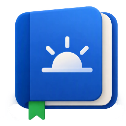

<p align="center"></p>

# Daybook

A small Windows desktop companion for the work day: one place to see what's on your plate today.

Four tabs:

- **Today**: your tasks for the day (doing, planned, done), with a short morning check-up.
- **Standup**: who has spoken, who is next, how long each person talked, and your own standup notes.
- **Retro**: subjects to bring up at the next retro, noted as they happen.
- **1:1**: progress on your objectives, plus issues and asks, for your next 1:1; progress is kept for the semester review.

## Features

**Today**
- Type a task and press **Enter**: it lands in **Planned**. **▶ Start** moves it to **Doing**, the checkbox marks it **Done**.
- **📣** flags a task as worth sharing; flagged tasks show up in **My standup notes** on the Standup tab.
  New tasks are flagged by default: click 📣 to keep a task private.
- A gentle hint appears when more than 3 tasks are in progress.
- Click a task to rename it; hover and click **✕** to delete (with undo).
- **Morning check-up**: on a new day a banner offers a 1-minute review in three steps: clear yesterday's done
  tasks, decide what happened to tasks in progress, keep or drop planned ones. Defaults are right if you just press
  **Continue**. **Later** leaves everything as it is.

**Standup**
- Click a name to give them the floor; the previous speaker is marked done automatically.
- **Next ▶** or the **Space** key moves to the next person.
- Each person gets an equal share of the meeting. Their bar shrinks green → amber, and turns red when they go over.
- Meeting clock shows the time left, then the time over.
- Right-click a name to mark them **away today**, or **off until** tomorrow, end of week, end of next week, or a
  date you pick (vacation, sick leave… no reason asked). Off people skip standups automatically and come back the
  next working day after their last day off; click them in the **Away** list to bring them back early.
- Right-click someone done to let them **talk again**.
- **My standup notes** lists your 📣 tasks: done yesterday, and doing or planned today.
- Order is shuffled by default. Every action can be undone from the toast at the bottom; there are no confirmation dialogs.

**Retro**
- Three columns: **Went well**, **Didn't go well**, **Ideas**. Type in the column it belongs to and press **Enter**.
- Each subject shows the day it was noted. Click to rename, hover and click **✕** to delete (with undo).
- During the retro, tick a subject once it's discussed. **Clear N discussed** removes those and keeps the rest for
  next time (with undo).

**1:1**
- In meeting order: **My objectives** for the semester, each with the subjects to share about it, then **Issues &
  asks**. Click **+ Add subject** under an objective (or **+ Add issue or ask**), type and press **Enter**.
- A win that fits no objective goes under **Outside objectives**, always last: it is kept for the review like the rest.
- On **Today**, hover a task and click **→ 1:1** to send it to an objective, **Outside objectives** or **Issues & asks** (the task stays as it is).
- During the meeting, tick what you covered. **Done with 1:1** moves ticked subjects to **Shared earlier**, removes
  ticked issues, and keeps the rest for next time (with undo). An issue still open after a 1:1 shows **Raised N×**.
- An objective you haven't talked about in 3 or more 1:1s shows **Not mentioned in last N 1:1s**.
- **Shared earlier** is the semester review: everything shared, grouped by objective, all editable. Click a date to
  change it, add an outcome (what your manager said), add a forgotten win, or send a subject back with
  **Not discussed**. **Copy** puts it all on the clipboard as plain text.
- A semester has no fixed dates: you start the next one with **Start new semester** after your review. Objectives
  carry over (edit them with **Edit**), and past semesters stay readable from **Shared earlier**. From mid-June and
  mid-December, a hint reminds you the review is coming.

**Edit team**
- Type a name and press **Enter** to add it. Paste a multi-line list to add several at once.
- Click a name to rename it, drag **⋮⋮** to reorder, hover and click **✕** to remove (with undo).
- An **Off until Fri 31 ✕** tag shows who is off; click its ✕ to end it early.
- No Save button: changes are stored immediately.

## Requirements

- Windows 10 or 11
- To run: [.NET 10 Desktop Runtime](https://dotnet.microsoft.com/download/dotnet/10.0)
- To build: [.NET 10 SDK](https://dotnet.microsoft.com/download/dotnet/10.0)

## Getting started

Run from source:

```bash
dotnet run --project src/Daybook.App
```

Publish a single-file exe (needs the .NET 10 Desktop Runtime on the target machine):

```bash
dotnet publish src/Daybook.App -c Release -r win-x64 --self-contained false -p:PublishSingleFile=true -o publish
```

Then run `publish\Daybook.App.exe`.

## Data

Everything is saved automatically under `%AppData%\Daybook\`:

- `team.json`: team, meeting length and "off until" dates.
- `tasks.json`: your tasks, and the date of the last morning check-up.

Delete a file to start that part over.
The standup itself (who has spoken, timings, "away today") lives in memory only and starts fresh on each launch.

## Project structure

```
Daybook/
├── design/
│   ├── daybook.ico        App icon (16, 24, 32, 48, 64, 128, 256 px)
│   └── icon-sheet.png     Designer's icon sheet, source for the .ico
├── src/Daybook.App/       WPF app (MVVM with CommunityToolkit.Mvvm)
│   ├── Models/            Team, Teammate, DayTask, TaskList, WorkDays
│   ├── Services/          TeamStore, TaskStore: JSON load/save
│   ├── ViewModels/        Today, Checkup, Standup, StandupNotes, EditTeam, Toast (undo), Main (tabs)
│   └── Views/             TodayView, StandupView, EditTeamView
└── tools/IconGen/         Builds daybook.ico from icon-sheet.png
```

Dependencies: [CommunityToolkit.Mvvm](https://www.nuget.org/packages/CommunityToolkit.Mvvm) and
[gong-wpf-dragdrop](https://www.nuget.org/packages/gong-wpf-dragdrop).

## Updating the icon

If the designer sends a new sheet as `.webp`, convert it to PNG first: Windows' WebP decoder drops transparency.

```bash
ffmpeg -i new-sheet.webp -pix_fmt rgba design/icon-sheet.png
dotnet run --project tools/IconGen -- design/icon-sheet.png design/daybook.ico
```

The tool removes the sheet background and shadows, cuts out each icon (the designer drew the small ones separately, so they stay crisp), and writes every size into the `.ico`. It expects the sheet's seven icons: 256, 128, 64, 48, 32, 24 and 16 px.

## Design principles

The UI follows Steve Krug's *Don't Make Me Think*:

- **Obvious what's clickable.** People waiting are buttons; people done are plain text.
- **One primary action** per screen (**Next ▶**, **Add**).
- **Undo instead of "Are you sure?"**
- **Few words, sensible defaults**, editing kept out of the run screen.

## License

[MIT](LICENSE)
